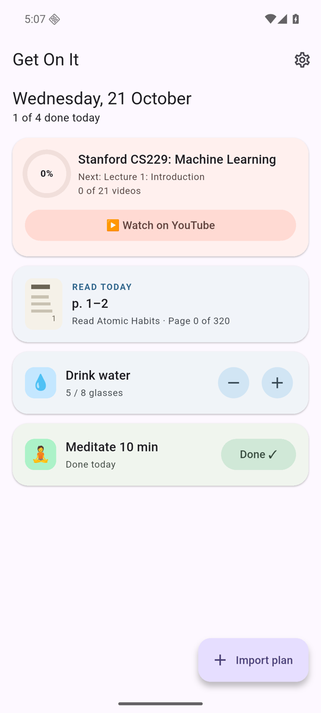
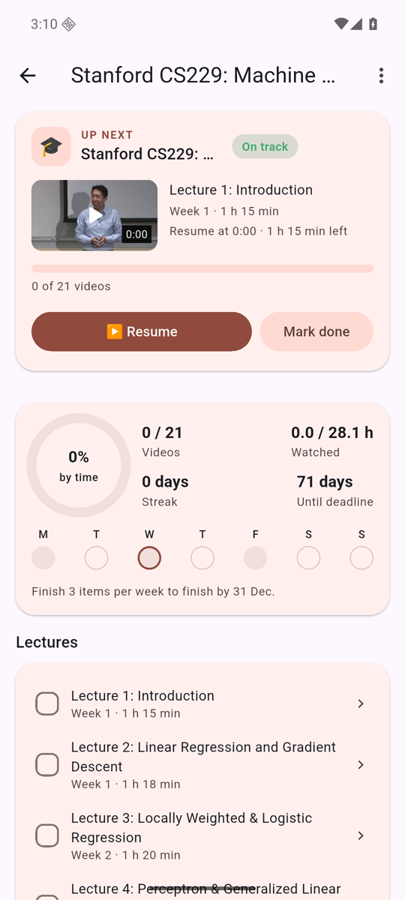
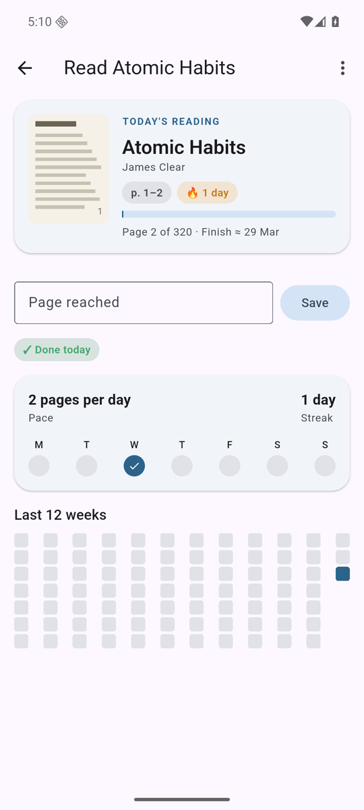
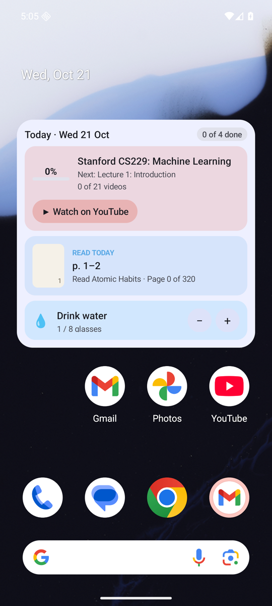
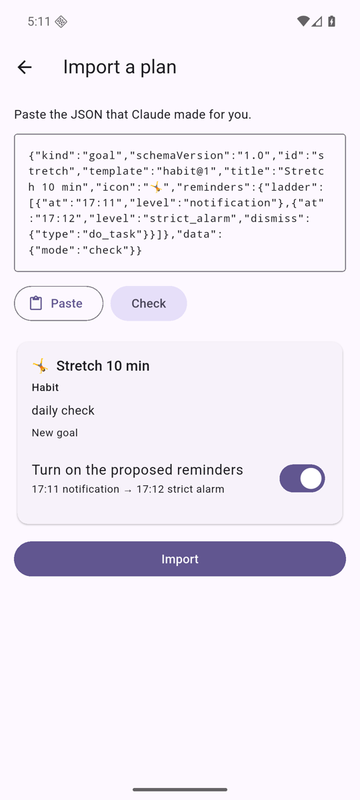
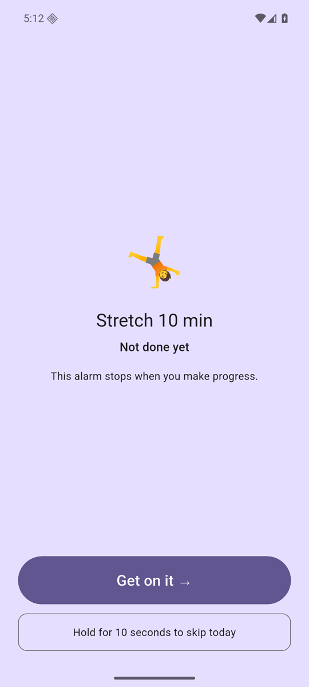
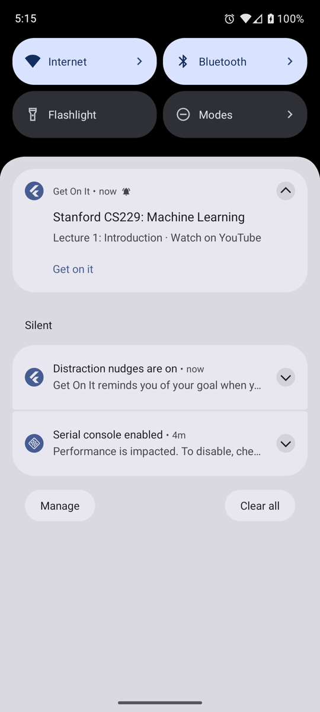
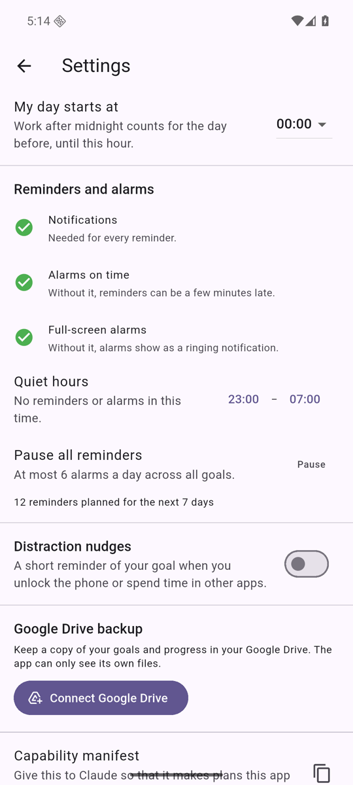

<p align="center"></p>

# Get On It

*Do the thing.*

Get On It is a goal and habit tracker for Android, built with Flutter. Any AI chat (for example ChatGPT or Claude) makes the plan. The app shows the plan, tracks your progress, and makes sure that you do the work.

<table align="center">
  <tr>
    <td align="center">
      <video src="https://github.com/user-attachments/assets/421319c1-01c6-4632-852b-563a5e63eac0" controls width="260"></video><br>
      <sub>Demo with narration (71 seconds). <a href="docs/demo.gif">Silent GIF</a></sub>
    </td>
    <td align="center">
      <a href="https://github.com/kamrul1157024/get-on-it/releases/latest/download/getonit.apk"></a><br>
      <b>Scan to download the app</b><br>
      <a href="https://github.com/kamrul1157024/get-on-it/releases/latest/download/getonit.apk">getonit.apk</a>
    </td>
  </tr>
</table>

Get On It is not affiliated with or endorsed by OpenAI or Anthropic. ChatGPT and Claude are named only as examples of AI chats.

## What it does

- **Plans from AI.** Paste or share a plan from any AI chat, for example ChatGPT or Claude. The app checks it and shows the real goal screen and both widgets before it saves anything. If something is wrong, **Fix with AI** copies a prompt with the exact problems.
- **Your own screens and widgets.** Ask the AI for a custom look, or use **Change the look with AI** on a goal. The plan and your progress stay.
- **Courses, books, and habits.** Watch YouTube lectures from where you stopped. Read today's PDF pages. Count glasses of water, tick a checklist, or avoid a habit.
- **Progress you can trust.** Streaks, pace against your deadline, and fixed daily targets. Progress is stored as events, so a new version of a plan keeps your progress.
- **Home-screen widgets.** A **Today** widget and a **Goal** widget. Buttons such as **+1** and **Done** work without opening the app.
- **Reminders that push.** Notifications, sticky reminders, full-screen alarms, and strict alarms that ring until you make progress. You approve every reminder.
- **Distraction nudges.** A short reminder of your goal when you unlock the phone or spend too long in an app that you choose.
- **Backup to your Google account.** Android backs up your goals and progress. A new phone gets them back. No setup.
- **Updates in the app.** When a new release is out, the app shows what changed and installs it for you.

## Screenshots

| Today | Course | Book | Home-screen widget |
|---|---|---|---|
|  |  |  |  |

| Import preview | Strict alarm | Unlock nudge | Settings |
|---|---|---|---|
|  |  |  |  |

## Get a plan

### 1. No install: copy a prompt

1. In the app, tap **Make a plan with AI**.
2. Say what you want, for example "Finish the Stanford CS229 lectures by 31 December, 3 days a week".
3. Tap **Copy prompt**, or **Copy and open Claude** / **Copy and open ChatGPT**.
4. Paste the prompt into the chat. Copy the whole answer.
5. In the app, tap **Import a plan**, then **Paste**, then **Import**.

To change a plan later, open the goal, tap **⋮ → Change plan with AI**, and say what should change. The prompt contains your plan and your progress, so the update keeps your progress.

### 2. Claude Code skill or plugin

The `getonit-planner` skill looks up real YouTube video IDs and durations, and it validates the plan before it gives it to you.

```bash
# As a plugin, from this repository's marketplace:
claude plugin marketplace add kamrul1157024/get-on-it
claude plugin install getonit-planner@get-on-it
```

```bash
# Or try it without installing:
claude --plugin-dir ./skill
```

Sample commands:

```bash
# Interactive
claude
/getonit-planner Make a plan to finish Stanford CS229 by 31 December, 3 study days a week

# Non-interactive
claude -p "Use the getonit-planner skill. Make a Get On It plan to read Atomic Habits (320 pages) by 2026-12-15, every day, with gentle reminders at 21:30. Save it as atomic-habits.getonit.json." \
  --allowedTools "Bash(python3 *)" "Write" "Read"
```

### 3. Codex, claude.ai, and the Claude API

The same skill works in other tools. For example, with OpenAI Codex:

```bash
cp -r skill/skills/getonit-planner ~/.agents/skills/
codex exec --sandbox workspace-write '$getonit-planner Make a Get On It plan to drink 8 glasses of water every day. Save it as water.getonit.json.'
```

[docs/skill-install.md](docs/skill-install.md) has the steps for each tool: Claude Code, claude.ai and Claude desktop, the Claude API, and Codex.

### Send the plan to the phone

- **Share** the file or the text to Get On It.
- **Open** a `.getonit.json` file with Get On It.
- **Paste** it in **Import a plan**.

## Install the app

Scan the QR code at the top with your Android phone, or open the link. It downloads `getonit.apk` from the latest release.

[Download getonit.apk](https://github.com/kamrul1157024/get-on-it/releases/latest/download/getonit.apk)

- Android asks you to allow installs from your browser the first time.
- You can also build the APK yourself (see below).

## Development

Requirements: Flutter (stable), Java 17, and the Android SDK. `flutter test` also needs `clang` on the host, because the PDF library compiles a small native helper.

| Command | Purpose |
|---|---|
| `make test` | Unit, widget, and host flow tests |
| `make e2e DEVICE=emulator-5554` | End-to-end tests on an emulator or a device |
| `make analyze` | Static analysis |
| `make apk` | Debug APK |
| `make gen` | Regenerate the database code after a table change |
| `cd mobile/android && ./gradlew :app:testDebugUnitTest` | Kotlin tests (nudge rules, widget renderer) |
| `python3 -m unittest discover -s skill/tests` | Skill tests |

CI runs all of these, including the e2e suite on an Android emulator. Releases: see [docs/release.md](docs/release.md).

## Documents

- [Technical specification](docs/tech-spec.md)
- [Skill and plugin installation](docs/skill-install.md)
- [Backup](docs/backup.md)
- [Google Drive setup (optional)](docs/drive.md)
- [Release process](docs/release.md)
- [Publish on Google Play](docs/play-store/checklist.md) and the [store listing texts](docs/play-store/listing.md)
- [Privacy policy](https://kamrul1157024.github.io/get-on-it/privacy)
- [Sample UI cards](mockups/cards.html). Open the file in a browser. A small JavaScript reference renderer draws each card from its JSON.
